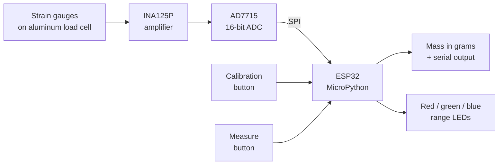

<div align="center">

# ⚖️ balance-beam-mass-force-sensor

**A hand-built, microcontroller-based mass sensor: custom aluminum load cells, strain gauges, an instrumentation amplifier, and a 16-bit ADC feeding an ESP32 that reports mass in grams. Built for the Science Olympiad Division C _Detector Building_ event (🥈 2nd place at state).**

<p align="center">
  &nbsp;&nbsp;
  &nbsp;&nbsp;
  &nbsp;&nbsp;
  &nbsp;&nbsp;
  
</p>

</div>

---

## 📌 TL;DR

| | |
|---|---|
| **What** | A scale that senses 0–1000 g using strain gauges on load cells we machined from 6061-T6 aluminum |
| **Signal chain** | 350 Ω strain gauges → INA125P instrumentation amp → AD7715 16-bit ADC (SPI) → ESP32 (MicroPython) |
| **Calibration** | On-device two-point system calibration (empty pan + 1000 g), then proportional scaling to grams |
| **Data** | 26-trial voltage-vs-mass dataset with loading and unloading sweeps |
| **Measured accuracy** | Median absolute error **4.7 g**; 19 of 24 non-zero trials within 30 g (3% of full scale). See [Results](#-results-and-key-findings). |
| **Competition** | Science Olympiad Division C, *Detector Building* · 🥈 2nd place at the state tournament |

## 🔍 Project Overview

This project is a complete mass-sensing system built from scratch: mechanical design, analog electronics, firmware, and data analysis. Neither of us had done electrical engineering or microcontroller programming before, so we learned each part while building it.

In Science Olympiad's **Detector Building** event, a team of two builds a student-made Mass/Force-sensing Device that measures unknown solid samples from 30 to 1,000 g and displays both the sensor voltage and the mass in grams. At the tournament, we get a few minutes to calibrate against the event supervisor's scale, then measure each unknown sample. Accuracy, LED zone indication, a written test, and a design log are all scored.

## 📋 Competition Context

Summarized from the Science Olympiad Division C Rules Manual (2023 edition). Rules can change between seasons, so check the current manual before reusing this design:

| Requirement | How this project meets it |
|---|---|
| Microcontroller, display, and three LEDs (red, green, blue) | ESP32 board; mass and voltage printed to a connected computer; red/green/blue LEDs |
| Participant-built sensor from fundamental components, circuits on a breadboard | Strain gauges bonded to load cells we machined ourselves; INA125P and AD7715 on a breadboard |
| Measures 30–1,000 g samples up to 8 cm across | Calibrated at 0 g and 1000 g; flat weighing plate |
| Display voltage and mass to the nearest 0.1 g | `main.py` prints both values (mass to 0.1 g) |
| No code libraries for calibration | Calibration is implemented in our own code; `main.py` imports only `machine`, `time`, and `struct` |
| LED zones set to ranges revealed on site | LED ranges are constants at the top of `main.py`, edited during the 5-minute setup |
| Design log with 8 sections (photo, 10+ trial data table, scatter plot, model graph, equation, code printout, LED code, cover) | Design log (see [Documentation](#-documentation)) |
| Disclose digital fabrication used | Mylar strain-gauge guide designed in Onshape and cut on a Glowforge laser cutter (documented in the log) |

**How it is scored:** each unknown mass earns an accuracy score of 15 points minus its relative error times a multiplier (20 at regionals, 30 at states, 40 at nationals), plus 4 points for lighting the correct LED. A written test (voltage dividers, force sensors, strain and resistance, calibration, and at states, Wheatstone bridges) and the design log make up the rest of the total.

## 🎯 Objectives and Goals

1. Machine load cells from 6061-T6 aluminum and bond strain gauges to them accurately.
2. Amplify and digitize the tiny strain-gauge signal reliably (INA125P + AD7715).
3. Write MicroPython firmware that calibrates itself and reports mass in grams.
4. Quantify how accurate the device is using a real calibration dataset.
5. Give the operator clear feedback with push buttons and LED range indicators.

## 🧪 Methodology



### Hardware

- **Load cells and plates:** designed and cut from 6061-T6 aluminum using a band saw, belt sander, and hand mill. Base plate and weighing plate are also 6061-T6, leveled with ¼-28 socket head cap screws and a bullseye level.
- **Strain gauge guide:** gluing gauges freehand broke wires and came out crooked, so we designed a placement guide in Onshape and laser-cut it from Mylar on a Glowforge.
- **Amplifier:** TI INA125P with a 33 Ω gain resistor (nominal gain of about 1820). A 10-turn potentiometer adjusts the Wheatstone bridge offset.
- **ADC:** Analog Devices AD7715 driven by a 1.0 MHz crystal. Its on-chip self-calibration and system-calibration modes do the zero and full-scale correction.
- **Controller:** SparkFun ESP32 IoT RedBoard. Bypass capacitors (10 µF tantalum and 0.1 µF Mylar) keep the supply clean.
- **Wiring:** 4-conductor shielded cable from the weighing plate to a 16-pin header on the breadboard.

### Pin map

| Signal | ESP32 GPIO |
|---|---|
| SPI clock / MOSI / MISO (SPI bus 2) | 18 / 23 / 19 |
| AD7715 chip select | 5 |
| AD7715 data-ready (RDY) | 26 |
| AD7715 reset | 27 |
| INA125P sleep (power-save between readings) | 25 |
| Calibration button / Measure button | 35 / 36 |
| Red / green / blue LED | 16 / 13 / 4 |

### Firmware flow

1. **Startup:** reset the AD7715 and run its internal self-calibration.
2. **Zero-scale calibration:** with an empty pan, press the calibration button.
3. **Full-scale calibration:** place the 1000 g weight, press the calibration button again. The ADC value for 1000 g is stored as `calFull`.
4. **Measurement loop:** press the measure button. The firmware wakes the amplifier, waits for it to settle, averages **25 ADC readings** (to reduce noise), and converts to grams:

```
mass (g) = average ADC reading × (1000 / calFull)
```

5. **Feedback:** the red, green, and blue LEDs light according to the measured mass range. The ranges in the code (red 30–250 g, green 249–600 g, blue 500–1000 g) are placeholders that we edit on site, because the event announces the real zones at setup. Zones can overlap, and at states and nationals more than one color may need to light at once. The amplifier then goes back to sleep.

## 📊 Results and Key Findings

We recorded 26 trials of voltage versus known mass: a loading sweep (0 → 1000 g), an unloading sweep (900 → 30 g), and two check points. We then replayed the on-device model (`mass = V × 1000 / 1.859`) against this data in the analysis notebook.

| Metric (on-device two-point model) | Result |
|---|---|
| Median absolute error | **4.7 g** |
| Trials within 30 g (3% of full scale) | **19 of 24** non-zero trials |
| Trials within 3% of the reading | 14 of 24 |
| Mean error, masses ≥ 400 g | **1.2%** |
| Worst single error | 118.9 g (trial 3, 50 g) |
| R² of voltage vs. mass (least-squares fit) | 0.989 |
| Replayed accuracy score per mass (our 24 logged calibration trials) | **12.2 / 15** under regional scoring, **11.4 / 15** under state scoring |

*The replayed score applies the manual's accuracy formula to our logged calibration data, with relative error as a fraction. It models the scoring formula and is not our tournament result: at the tournament, the device measured different unknown masses, and our placement also reflected the LED points, written test, and design log.*

**Key findings**

- **The relationship is very linear.** Voltage tracks mass almost proportionally from 0 to 1000 g (about 1.86 V at 1000 g), which is why a two-point calibration works.
- **Error is concentrated at low mass.** Outliers cluster at 50–300 g (up to about 119 g), consistent with the noisy early data and with our observation that the 100 g reading was the weakest.
- **The unloading sweep is clean.** Trials 14–19 (900 → 400 g) are all within 1% of the reading.
- **The 1000 g repeat check landed within 0.2%.**

## 🗃️ Dataset

The analysis uses 26 calibration trials, each pairing a known mass with the sensor voltage it produced.

| Item | Description |
|---|---|
| Rows | 26 trials: a loading sweep (0 → 1000 g), an unloading sweep (900 → 30 g), and two check points |
| Columns | Known mass in grams and measured sensor voltage in volts |

## 🛠️ Engineering Notes: What Went Wrong, and What We Fixed

- **Regionals:** the code returned only zeros or full-scale values for days. We re-checked wiring, found missing connections and misplaced wires, and rebuilt the circuit around each chip's requirements.
- **States:** after weeks of debugging for 6–10 hours a week, readings finally became non-zero, then stable. Our final design log reported results within 0–90 g of the expected values, with the 100 g point the least accurate. The later analysis above, which uses the full 26-trial dataset, found a worst single error of 118.9 g.
- **Lesson:** hardware and software bugs look identical (all zeros), so verifying each stage of the signal chain separately saved the most time.

## 🚀 Installation and Setup

### 1. Set up the project locally

**You need:** an ESP32 board flashed with [MicroPython](https://micropython.org/download/ESP32_GENERIC/), the circuit above, and [Thonny](https://thonny.org/) or `mpremote`.

```bash
# 1. Clone
git clone https://github.com/NehaM2025/balance-beam-mass-force-sensor.git
cd balance-beam-mass-force-sensor

# 2. Copy the firmware to the board (it runs automatically on boot as main.py)
pip install mpremote
mpremote connect auto cp "scale_code_4_13testa (1).py" :main.py

# 3. Open the serial console to follow the prompts
mpremote connect auto repl
```

### 2. Calibrate and use the scale (the "training" step)

This project has no trained model. The device learns its scale factor from the two calibration steps below, which are the equivalent of training.

1. Power the board and watch the serial console.
2. Empty the pan and press the **calibration** button.
3. Place the 1000 g weight and press **calibration** again.
4. Place an object and press the **measure** button. Read grams in the console and see the range LEDs.
5. Remove the object and repeat.

### 3. Evaluate performance (on your computer)

Walk through the analysis step by step in the analysis notebook. It prints the error metrics and draws the calibration curve and the error-by-mass plot. Run it in Colab with the badge below, or locally:

```bash
pip install numpy pandas matplotlib notebook
jupyter notebook calibration-analysis.ipynb
```

[](https://colab.research.google.com/github/NehaM2025/balance-beam-mass-force-sensor/blob/main/calibration-analysis.ipynb)

## 📚 Documentation

| Document | What it covers |
|---|---|
| This README | User guide: setup, calibration, operation, and results |
| [API Reference](API%20Reference.md) | Firmware reference: configuration constants, the `AD7715` driver, program flow, and troubleshooting |
| [Design log (PDF)](Design%20Log%20Project%20Documentation.pdf) | Competition design log with build photos |
| [Analysis notebook](calibration-analysis.ipynb) | Annotated walkthrough of the data analysis |
| [Firmware source](scale_code_4_13testa%20%281%29.py) | The MicroPython code that runs on the ESP32 |

## 🗂️ Repository Structure

```
balance-beam-mass-force-sensor/
├── README.md
├── scale_code_4_13testa (1).py              # MicroPython firmware (copied to the board as main.py)
├── calibration-analysis.ipynb               # annotated analysis notebook
├── API Reference.md                         # firmware reference
└── Design Log Project Documentation.pdf     # full design log with build photos
```

## 🔭 Potential Next Steps

- **Multi-point calibration:** calibrate at several known weights (for example 0, 200, 500, 1000 g) and use piecewise-linear interpolation to fix the low-mass error.
- **Noise handling:** use the median of the 25 readings and reject outliers before averaging.
- **Auto-zero and drift tracking:** the firmware already collects zero readings but does not yet use them to correct drift.
- **Firmware cleanup:** remove the unused warm-up loop and commented-out code, and move constants (such as the 1.859 V full-scale value) into one config block.
- **Data logging:** stream each reading to a CSV over serial to build a larger dataset and test temperature effects.

## 🙋 Individual Contributions

Built by a two-person team. Together, we:

- Designed and machined the 6061-T6 aluminum load cells, base plate, and weighing plate (band saw, belt sander, hand mill).
- Designed the strain-gauge placement guide in Onshape and laser-cut it from Mylar on a Glowforge.
- Bonded the strain gauges, soldered the shielded cable and header, and assembled the circuit on a breadboard.
- Wrote the MicroPython firmware: the AD7715 SPI driver, zero and full-scale system calibration, 25-sample averaging, and LED zone logic.
- Collected the 26-trial calibration dataset and wrote the competition design log.
- Added the post-competition analysis in this repo (error metrics, plots, and an estimate of the event accuracy score).

---
